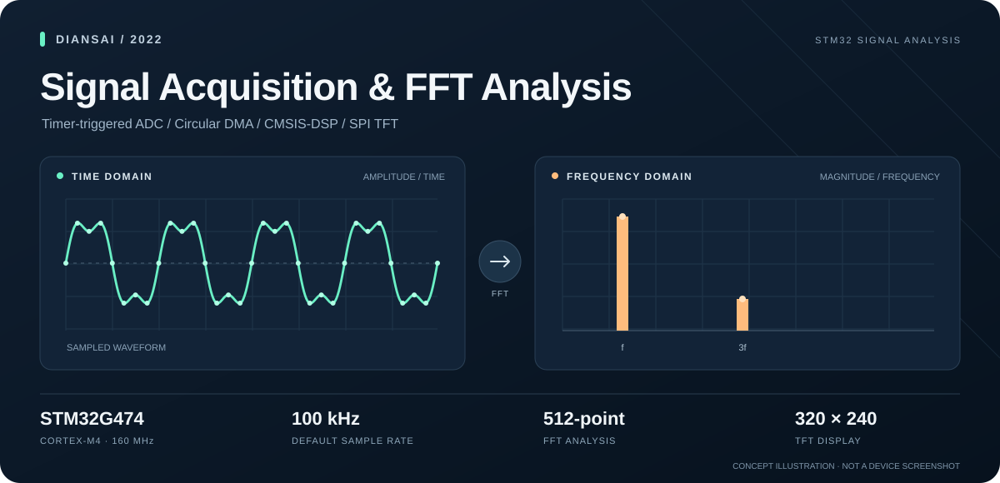
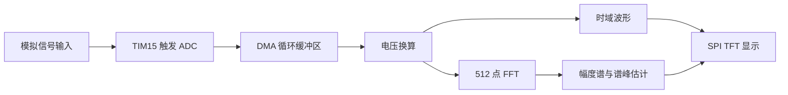
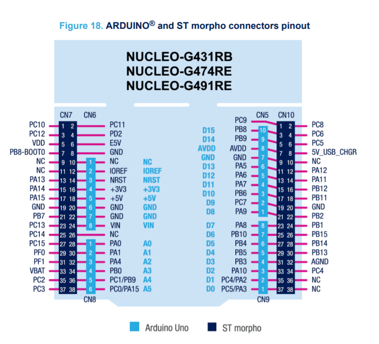

# DianSai2022

**基于 STM32G474 的信号采集与频谱分析系统**

12 位 ADC · DMA 循环采样 · 512 点 FFT · TFT 波形显示

基于 STM32G474RET6 实现模拟信号采集、时域波形显示和 FFT 频谱分析，支持通过按键切换显示模式、调整采样率。项目采用 STM32 HAL 与 CMSIS-DSP，在裸机环境下完成采集、计算和显示。

波形与频谱为功能示意，非实机截图。

## 主要功能

- **信号采集**：12 位 ADC 单通道采样，定时器触发转换，DMA 循环搬运 512 点数据；默认采样率为 100 kHz，可通过按键调整。
- **时域显示**：将采样值换算为电压，在 320×240 TFT 彩屏上绘制波形，支持纵轴自动缩放与旧波形擦除。
- **频谱分析**：使用 CMSIS-DSP 完成 512 点浮点 FFT 和幅值计算，显示频谱，并根据谱峰位置估算频率。
- **按键交互**：KEY1 显示波形，KEY2 显示频谱，KEY3 / KEY4 降低或提高采样率，操作时提供蜂鸣器反馈。

屏幕显示采样率与谱峰频率估计值。当前数据处理和界面刷新由按键事件触发。

## 技术方案

系统以 **STM32G474RET6（Cortex-M4，160 MHz）** 为主控，使用定时器中断与主循环组织任务。

采样由 **TIM15 + ADC1 + DMA** 配合完成；频谱计算使用 **CMSIS-DSP**；显示部分通过 **SPI** 驱动 TFT，并根据数据范围缩放曲线。按键采用定时扫描和软件消抖，蜂鸣器由 PWM 控制。

## 工程结构

- `Admin/`：应用逻辑，包括数据处理、FFT、波形绘制、按键与中断回调。
- `Core/`：程序入口及 CubeMX 生成的外设初始化代码。
- `Lib/`：TFT 驱动、GUI、字体及辅助库。
- `Drivers/`、`Middlewares/`：STM32 HAL、CMSIS 与 DSP 库。
- `MDK-ARM/`：Keil 工程与启动文件。

## 开发与运行

使用 **Keil MDK 5 / ARM Compiler 5** 打开 `MDK-ARM/DianSai2022.uvprojx`，安装 STM32G4 设备支持包后编译，通过 ST-LINK 下载。外设配置文件为 `DianSai2022.ioc`，可使用 STM32CubeMX 打开。

上电后屏幕显示 `HELLO!`，接入信号并短按 KEY1 或 KEY2，即可显示波形或频谱。

<b>硬件连接与引脚参考</b>

主要硬件为 STM32G474 开发板、SPI TFT 彩屏、四个按键和蜂鸣器。模拟输入使用 **PB0 / ADC1_IN15**，输入信号需共地并符合 ADC 输入范围。具体外设连接见 `Core/Inc/main.h` 与 CubeMX 配置。

## 项目状态

当前已实现采集、波形显示、FFT 频谱分析和按键控制。频率读数采用谱峰估计，采样同步与幅值计算仍需完善；FIR 滤波等实验代码已保留，但尚未启用。
